# Lab 3 — Teardown, and the same machine from the command line

**Course:** Operating System Architecture (IFT 103) · **Week 4** · **Group:** CYB26-5

The first half is a teardown on paper: ten real products, read from their makers' own websites.
The second half reads CPU, memory and disk facts from the command line on two operating systems — my **MacBook Air (macOS, the host)** and my **Ubuntu Server VM in UTM** — and compares how each one names the same fact.

```
labs/lab03-teardown/
├── README.md
└── evidence/
    ├── photos/            ← screenshots of each maker's product page
    ├── macos-specs.txt    ← raw output, host laptop (macOS, Apple M1)
    └── linux-specs.txt    ← raw output, Ubuntu VM in UTM (ARM64)
```

---

## Part 1 — The ten components

Each part follows the same pattern: **what it is → what it connects to → what limits it**.
Every screenshot is taken from the maker's own page, linked under each part (screenshots taken 9 Nov 2026).

### 1. AMD Ryzen 5 7600
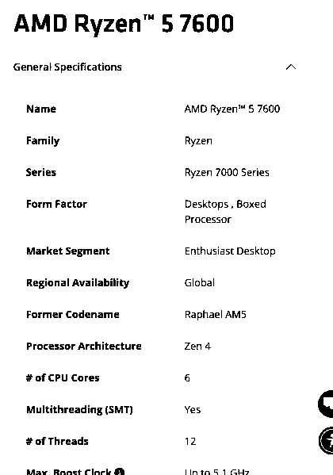

**What it is:** desktop CPU, Zen 4 ("Raphael AM5"), 6 cores / 12 threads, 3.8 GHz base, up to 5.1 GHz boost, 32 MB L3, 65 W default TDP, built-in AMD Radeon graphics (2 cores).
**Connects to:** socket **AM5**. AMD lists the supporting chipsets: A620, X670E, X670, **B650E, B650**, X870E, X870, B840, B850. Memory controller: **DDR5 only**, 2 channels, up to 128 GB. PCIe 5.0, 24 usable lanes.
**Limit:** fits only AM5 boards and only DDR5. Official memory speed is **DDR5-5200** with two modules (DDR5-3600 with four) — anything faster is an overclock (EXPO). Tjmax 95 °C.
**Maker's page:** https://www.amd.com/en/products/processors/desktops/ryzen/7000-series/amd-ryzen-5-7600.html

### 2. Intel Core i5-13400
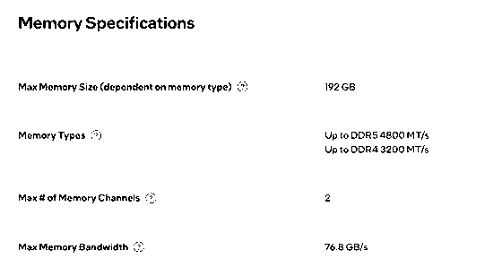
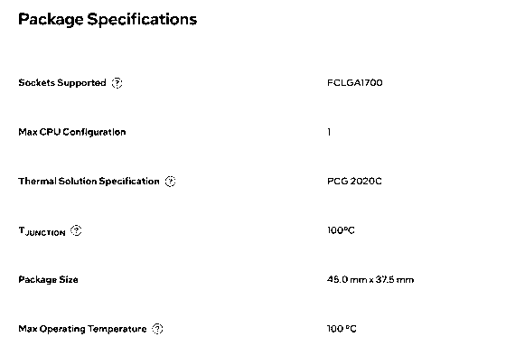

**What it is:** 13th-gen Intel Core (Raptor Lake), 10 cores (6 Performance + 4 Efficient), 16 threads, P-core base 2.5 GHz, max turbo 4.6 GHz, 20 MB Intel Smart Cache, 65 W base power, integrated Intel UHD Graphics 730.
**Connects to:** socket **FCLGA1700**. Memory: **DDR5 up to 4800 MT/s or DDR4 up to 3200 MT/s**, 2 channels, up to 192 GB — which one is used depends on the board's slots. PCIe 5.0 and 4.0, 20 lanes.
**Limit:** LGA 1700 boards only; locked multiplier (no "K"). Intel's page gives only the thermal specification (**PCG 2020C**) and does not name a cooler; a boxed version exists (ordering code **BX8071513400**), a tray CPU comes without one.
**Maker's page:** https://www.intel.com/content/www/us/en/products/sku/230495/intel-core-i513400-processor-20m-cache-up-to-4-60-ghz/specifications.html

### 3. ASUS PRIME B650M-A
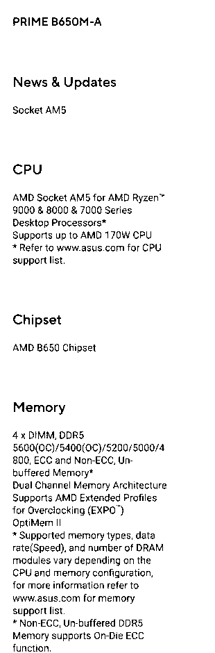

**What it is:** micro-ATX motherboard, AMD **B650** chipset, socket **AM5**.
**Connects to:** AMD Ryzen 9000 / 8000 / 7000 CPUs (up to 170 W); **4 × DDR5 DIMM**, dual channel, 4800–5200 standard, 5400/5600 only as overclock; 2 × M.2 Key M (M.2_1 runs **PCIe 5.0 x4** with a Ryzen 7000/9000, M.2_2 PCIe 4.0 x4 from the chipset); 4 × SATA 6 Gb/s; 1 × PCIe 4.0 x16 slot; DisplayPort, HDMI and VGA outputs for the CPU's graphics; 24-pin + 8-pin power.
**Limit:** AM5 CPUs only, DDR5 only, needs a micro-ATX (or larger) case.
**Maker's page:** https://www.asus.com/motherboards-components/motherboards/prime/prime-b650m-a/techspec/

### 4. MSI PRO B760M-A WIFI DDR4
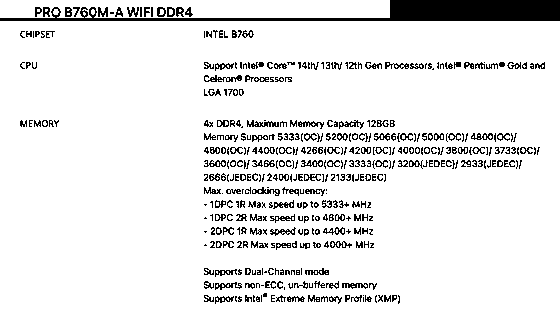

**What it is:** micro-ATX motherboard, Intel **B760** chipset, socket **LGA 1700**, Wi-Fi 6E and 2.5G LAN.
**Connects to:** Intel Core 14th / 13th / 12th gen, Pentium Gold and Celeron; **4 × DDR4** (up to 128 GB, 3200 JEDEC, up to 5333 as XMP overclock); 2 × M.2 (M.2_1 from the CPU, PCIe 4.0 x4; M.2_2 from the chipset, PCIe 4.0 x4 or SATA); **4 × SATA 6G**; 2 × HDMI 2.1 and 2 × DisplayPort 1.4 (only with a CPU that has graphics); 1 × ATX_PWR + 2 × CPU_PWR.
**Limit:** LGA 1700 only; **DDR4 only** — a DDR5 module does not fit the slot.
**Maker's page:** https://www.msi.com/Motherboard/PRO-B760M-A-WIFI-DDR4/Specification

### 5. Kingston FURY Beast DDR5-5600, 16 GB (KF556C40BB-16)
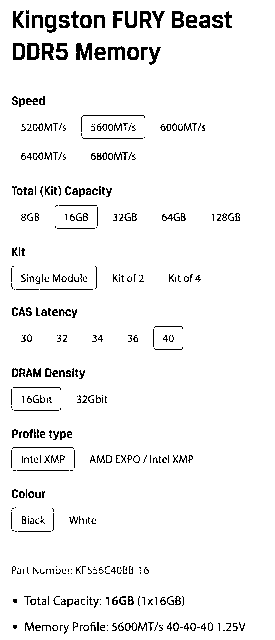

**What it is:** DDR5 desktop DIMM, part number **KF556C40BB-16**: 16 GB (1 × 16 GB), 5600 MT/s, timings 40-40-40, 1.25 V, 16 Gbit chips, profile type **Intel XMP** (Kingston sells the "AMD EXPO / Intel XMP" variant under a different part number).
**Connects to:** a 288-pin DDR5 DIMM slot, one module per channel.
**Limit:** DDR5 boards only (the notch is in a different place than on DDR4). One module = single channel. On the Ryzen 5 7600 the official speed is DDR5-5200, so 5600 is an overclock.
**Maker's page:** https://www.kingston.com/en/memory/gaming/kingston-fury-beast-ddr5-memory (5600 MT/s · 16 GB · Single Module · CL40 · 16 Gbit · Intel XMP · Black)

### 6. Crucial DDR4-3200, 16 GB UDIMM (CT16G4DFRA32A)
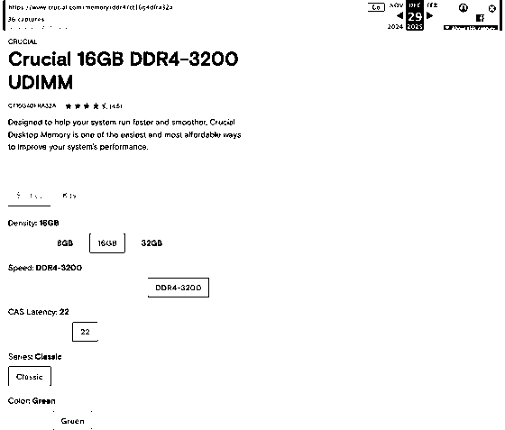

**What it is:** DDR4 desktop UDIMM, part number **CT16G4DFRA32A**: 16 GB, DDR4-3200, CAS latency 22, single module.
**Connects to:** a 288-pin DDR4 DIMM slot.
**Limit:** DDR4 boards only; full-size UDIMM, so it does not fit a laptop (SO-DIMM). 3200 MT/s is exactly the i5-13400's official DDR4 speed.
**Maker's page:** https://www.crucial.com/memory/ddr4/ct16g4dfra32a — the live page loads, but its specification section returns a 404, so the screenshot is the Wayback Machine copy of the same Crucial page (29 Dec 2025): https://web.archive.org/web/20251229164412/https://www.crucial.com/memory/ddr4/ct16g4dfra32a

### 7. Samsung 990 PRO 1 TB
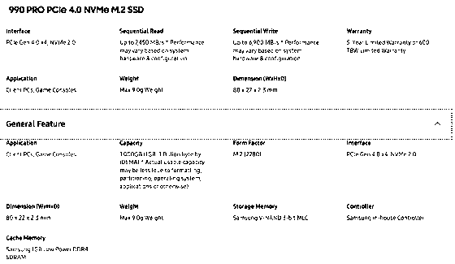

**What it is:** NVMe SSD, form factor **M.2 (2280)**, 80 × 22 × 2.3 mm, interface **PCIe Gen 4.0 x4, NVMe 2.0**, up to 7,450 MB/s read and 6,900 MB/s write, Samsung in-house controller, 1 GB LPDDR4 cache, 600 TBW warranty.
**Connects to:** an M.2 Key M slot wired to PCIe lanes; no cables.
**Limit:** needs an NVMe/PCIe M.2 slot (not SATA-only); it cannot use the PCIe 5.0 speed of the ASUS M.2_1 slot — it stays at Gen 4 speed.
**Maker's page:** https://www.samsung.com/uk/memory-storage/nvme-ssd/990-pro-1tb-nvme-pcie-gen-4-mz-v9p1t0bw/

### 8. Samsung 870 EVO 1 TB
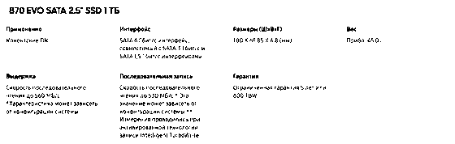

**What it is:** **2.5-inch SATA SSD**, 100 × 69.85 × 6.8 mm, SATA 6 Gb/s (compatible with 3 and 1.5 Gb/s), up to 560 MB/s read and 530 MB/s write, 600 TBW warranty.
**Connects to:** a SATA port on the board (data cable) + SATA power from the PSU; sits in a 2.5" bay.
**Limit:** the SATA bus caps it at about 560 MB/s — roughly 13 × slower than the 990 PRO.
**Maker's page:** https://www.samsung.com/kz_ru/memory-storage/sata-ssd/870-evo-1tb-sata-3-2-5-ssd-mz-77e1t0bw/

### 9. Corsair RM750e (750 W)
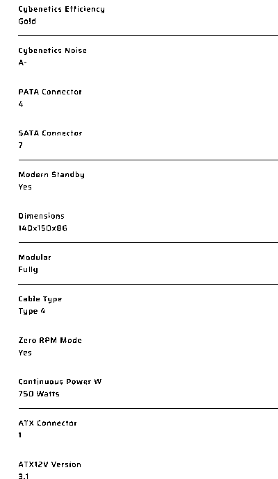

**What it is:** ATX power supply, **750 W continuous**, 80 PLUS Gold, ATX12V **3.1**, fully modular (cable type 4), 140 × 150 × 86 mm.
**Connects to:** the wall; inside — 1 × 24-pin ATX to the board, CPU power to the board's CPU_PWR, **7 × SATA** power, 4 × PATA (Molex), PCIe cables for a graphics card.
**Limit:** 750 W total; ATX size. There is **only one**, so only one build gets it.
**Maker's page:** https://www.corsair.com/us/en/p/psu/cp-9020262-na/rme-series-rm750e-fully-modular-low-noise-atx-power-supply-cp-9020262-na

### 10. Stock cooler — AMD Wraith Stealth
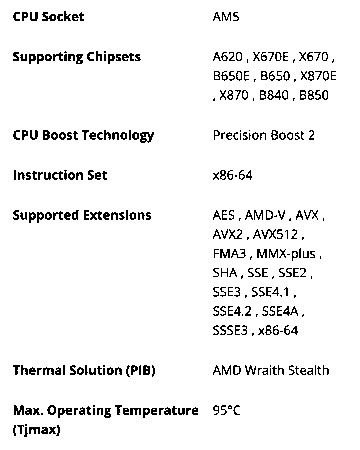

**What it is:** the low-profile air cooler that ships in the Ryzen 5 7600 retail box — AMD lists **Thermal Solution (PIB): AMD Wraith Stealth** (PIB = processor in box).
**Connects to:** the **AM5** mounting on top of the CPU; its fan plugs into CPU_FAN.
**Limit:** sized for the 65 W CPU it ships with — fine at stock, weak for overclocking.
**Maker's page:** same AMD page as part 1.

---

## Part 1b — The motherboards, and two computers that would work

| | ASUS PRIME B650M-A | MSI PRO B760M-A WIFI DDR4 |
|---|---|---|
| Socket | AM5 | LGA 1700 |
| Chipset | AMD B650 | Intel B760 |
| Memory | DDR5, 4 × DIMM | DDR4, 4 × DIMM |
| Storage | 2 × M.2 (Gen 5 x4 + Gen 4 x4), 4 × SATA | 2 × M.2 (Gen 4 x4, M2_2 also SATA), 4 × SATA |
| CPUs accepted | Ryzen 9000, 8000, 7000 | Core 14th, 13th, 12th gen, Pentium Gold, Celeron |
| BIOS for our CPU | ASUS CPU support list: Ryzen 5 7600 validated **since BIOS 0602** — check the BIOS version is 0602 or newer | MSI CPU support list: i5-13400 listed with BIOS **7D99v10** (the earliest one listed) — no update needed |

BIOS sources: [ASUS CPU support](https://www.asus.com/motherboards-components/motherboards/prime/prime-b650m-a/helpdesk_qvl_cpu?model2Name=PRIME-B650M-A) · [MSI CPU support](https://www.msi.com/Motherboard/PRO-B760M-A-WIFI-DDR4/support#cpu)

The rule: **CPU socket = board socket**, and **memory type = what the board's slots take**.

| Part | Build A — AMD | Why here | Build B — Intel | Why here |
|---|---|---|---|---|
| CPU | Ryzen 5 7600 | AM5 CPU | Core i5-13400 | LGA 1700 CPU |
| Motherboard | ASUS PRIME B650M-A | AM5; B650 is on AMD's chipset list | MSI PRO B760M-A WIFI DDR4 | LGA 1700; 13th gen on MSI's list |
| Memory | Kingston FURY Beast DDR5-5600 | board and CPU are DDR5-only; runs at 5200 officially, 5600 as an overclock | Crucial DDR4-3200 | board is DDR4-only; 3200 = the CPU's official DDR4 speed |
| Storage | Samsung 990 PRO (M.2 NVMe) | M.2 Key M slot with PCIe lanes, no cables | Samsung 870 EVO (SATA) | board has 4 × SATA 6G |
| Cooler | Wraith Stealth (in the CPU box) | AM5 mounting, 65 W | Intel boxed cooler — only if the i5 is bought boxed (BX8071513400) | the parts list has only one cooler, and it is AMD's |
| PSU | Corsair RM750e | 24-pin + CPU power; far more than this build needs | **missing** | — |
| Graphics | Radeon iGPU in the CPU | board has DP / HDMI / VGA | UHD 730 iGPU in the CPU | board has HDMI / DP |

**What each build still needs**

- **Build A (AMD):** a micro-ATX case, an operating system. A second DDR5 module would add the second memory channel.
- **Build B (Intel):** **a power supply** (the only PSU went to Build A), a SATA data cable for the 870 EVO, a cooler if the CPU is a tray version, a micro-ATX case, an operating system. A second DDR4 module for dual channel.

Neither build needs a graphics card — both CPUs have integrated graphics and both boards have video outputs.

---
## Part 2 — The same facts from the command line

Raw outputs:
- [`evidence/macos-specs.txt`](evidence/macos-specs.txt) — **host laptop**, MacBook Air M1, macOS, `system_profiler`
- [`evidence/linux-specs.txt`](evidence/linux-specs.txt) — **Ubuntu Server 26.04.1 LTS running as a UTM virtual machine** on that Mac

> The Linux output describes the **virtual machine**, not the Mac. UTM gives it 2 CPU cores, 2048 MiB of RAM and a ~14 GB VirtIO disk, and that is what Linux sees.
>
> Windows: nobody in my setup runs Windows natively on this Mac, so the Windows column lists the equivalent PowerShell command for reference only (not run).

| Fact | macOS — host (`system_profiler`) | Linux — Ubuntu VM in UTM | Windows (not run) |
|---|---|---|---|
| CPU model | `Chip: Apple M1` | not printed by the commands I ran; UTM runs the VM as a *QEMU ARM Virtual Machine* with the host CPU type | `Get-CimInstance Win32_Processor \| Select Name` |
| Cores | `Total Number of Cores: 8 (4 performance and 4 efficiency)` | 2 (set in UTM) | `NumberOfCores`, `NumberOfLogicalProcessors` |
| Architecture | Apple M1 = ARM (Apple calls it **arm64**) | `uname -a` → **aarch64** | `$env:PROCESSOR_ARCHITECTURE` |
| Total memory | `Memory: 8 GB` | 2048 MiB given by UTM; login summary: `Memory usage: 15%` | `Get-CimInstance Win32_PhysicalMemory` |
| Disk model and type | `Device Name: APPLE SSD AP0256Q`, `Medium Type: SSD`, `Protocol: Apple Fabric` | a VirtIO virtual disk (qcow2 file on the Mac), not the Apple SSD | `Get-PhysicalDisk \| Select FriendlyName, MediaType, BusType, Size` |
| Disk size / free | `Capacity: 245,11 GB`, `Free: 187,46 GB` | login summary: `Usage of /: 40.5% of 14.14GB` → about 8.4 GB free | `Get-Volume C` |
| Kernel / OS | macOS (Darwin) | `Linux makromak 7.0.0-38-generic … aarch64`, `Ubuntu 26.04.1 LTS` | `Get-ComputerInfo` |

### What the comparison shows

1. **Same fact, different names.** macOS says `Chip`, Linux's `lscpu` says `Model name`, Windows says `Name`. macOS says `Total Number of Cores`, Linux says `CPU(s)`.
2. **Same architecture, two names.** Apple calls the M1 architecture **arm64**; Linux on the same chip prints **aarch64**. Both mean 64-bit ARM.
3. **The locale changes the numbers.** My Mac is set to Russian, so `system_profiler` prints `245,11 GB` with a decimal **comma** and `245 107 195 904 bytes` with spaces. A script that parses this output would break on another Mac with English settings.
4. **The VM does not see the real machine.** The Mac has 8 cores and 8 GB; the VM sees the 2 cores and 2 GB that UTM gave it. The Mac's disk is an `APPLE SSD` on `Apple Fabric`; the VM sees a VirtIO disk of about 14 GB — which is really a qcow2 file of 7.16 GB on the Mac.
5. **Back to Part 1.** The M1's memory is part of the chip package (unified memory), so `system_profiler` shows `Memory: 8 GB` with no slots and no module list. Unlike the DIMMs in Part 1, it cannot be upgraded — 8 GB is the limit I had to plan my VMs around.

---

## What did not work the first time

- **The ping in my command line.** I typed `ping -4 c ubuntu.com` instead of `ping -4 -c 4 ubuntu.com`. Ping took `c` as the host name and answered `ping: c: Temporary failure in name resolution` (see `linux-specs.txt`). It was my typo, not a network problem: the same VM had an address (`192.168.64.2`) and reached the internet in Ticket 1.
- **Text sent into the UTM console turned into `aaaa…`.** Typing a whole command into the VM window from automation gave only the letter `a`: the UTM console works with raw key codes, and those characters arrived without a proper key code. Plain Enter worked. I kept the outputs that were typed by hand on the keyboard.
- **The Crucial page.** The product page opens, but its specification block returns a *404*. I used the Wayback Machine copy of the same Crucial URL for the screenshot.
- **Samsung pages by region.** The 990 PRO page is missing on the Kazakhstan site (404) and the 870 EVO page is missing on the UK site, so the two Samsung screenshots come from different regional Samsung sites.

## Evidence

- [evidence/photos/](evidence/photos/) — screenshots of the ten makers' product pages (taken 9 Nov 2026)
- [evidence/macos-specs.txt](evidence/macos-specs.txt) — `system_profiler` output from the Mac (identifiers removed)
- [evidence/linux-specs.txt](evidence/linux-specs.txt) — commands and output from the Ubuntu VM in UTM

*Use of AI: Claude (Anthropic) was used to read the makers' pages, take and crop the screenshots, check the specifications and draft this README. The command output is from my own Mac and VM.*
