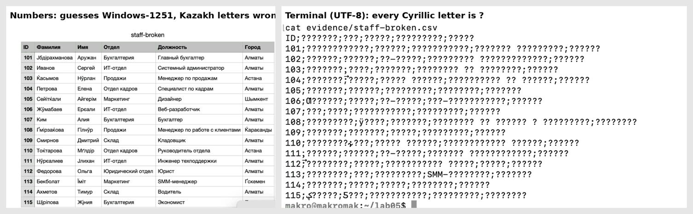
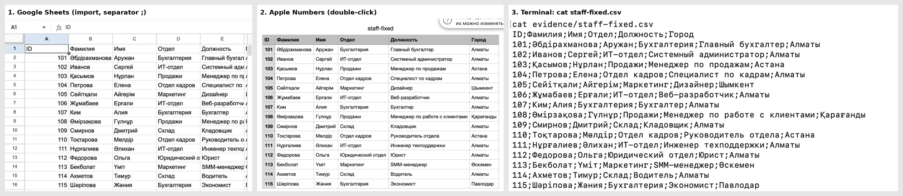

# Lab 5 — Encoding forensics

Name: Arsen Yermakanov · Group: CYB26-5 · Date: 14 November 2026
Tools: Ubuntu Server 26.04 guest in UTM on a MacBook (Apple M1), over SSH from the macOS Terminal (`file`, `xxd`, `iconv`); Google Sheets; Apple Numbers

## Diagnosis — in one line

**KZ-1048 (RK1048), CRLF line endings, no BOM, separator `;`.**

## What I received



- **Terminal (`cat`, UTF-8 locale):** `ID` and the numbers are fine, every Cyrillic letter is shown as `?` — the bytes are not valid UTF-8.
- **Apple Numbers (double-click):** opened without an import dialog and guessed Windows-1251. Russian names are correct, but every Kazakh letter is wrong: `Јбдірахманова`, `Ќасымов`, `Нўрлан`, `Ґскемен`.
- The separator is `;`, not a comma.

## Diagnosis (made before the fix)

- **`file` said:** `Non-ISO extended-ASCII text, with CRLF line terminators` ([evidence/file-before.txt](evidence/file-before.txt)) — i.e. "some one-byte code page", without saying which.
- **First 16 bytes:** `49 44 3b d4 e0 ec e8 eb e8 ff 3b c8 ec ff 3b ce` ([evidence/hexdump-before.txt](evidence/hexdump-before.txt))
- **Encoding: KZ-1048 (in iconv: `RK1048`)** — because:
  - one byte per letter: `Фамилия` is the 7 bytes `d4 e0 ec e8 eb e8 ff`, so it is a code page, not UTF-8 (which would be 14 bytes, `d0 xx` pairs);
  - Russian letters match the Windows-1251 table (`а` = `e0`, `я` = `ff`);
  - but the first surname starts with the byte `a3` (`a3 e1 e4 b3 f0 e0 …`). In Windows-1251 `a3` is `Ј` and gives "Јбдірахманова"; in KZ-1048 `a3` is `Ә` and gives **Әбдірахманова**. Kazakh letters do not exist in Windows-1251 at all.
  - Checked by decoding both ways:

```
$ iconv -f WINDOWS-1251 -t UTF-8 evidence/staff-broken.csv | head -n 4
101;Јбдірахманова;Аружан;Бухгалтерия;Главный бухгалтер;Алматы
103;Ќасымов;Нўрлан;Продажи;Менеджер по продажам;Астана
$ iconv -f RK1048 -t UTF-8 evidence/staff-broken.csv | head -n 4
101;Әбдірахманова;Аружан;Бухгалтерия;Главный бухгалтер;Алматы
103;Қасымов;Нұрлан;Продажи;Менеджер по продажам;Астана
```

- **Line ending: CRLF** — because line 1 (`…Город`) ends with the bytes `0d 0a` (offset `0x24`).
- **BOM: no** — because the file starts directly with `49 44` (`ID`), not `EF BB BF` or `FF FE`.
- **Separator:** `;`

### Decisions for the fixed file

- **BOM: added.** The brief says the file must open correctly everywhere, including Excel by double-click. Excel only recognises UTF-8 on double-click when the file starts with `EF BB BF`; without it, it falls back to the local code page and shows mojibake again. The price is that some Linux scripts would read the BOM as part of the first column name.
- **Line ending: kept CRLF.** The file is for Windows/Excel users, and `cat`, Numbers and Google Sheets all read CRLF correctly.

## Fix

[scripts/fix.sh](scripts/fix.sh), run from `labs/lab05-encoding/` with `sh scripts/fix.sh`:

```sh
#!/bin/sh
# Lab 5: convert staff-broken.csv from KZ-1048 (RK1048) to UTF-8 with BOM, keep CRLF
in=evidence/staff-broken.csv
out=evidence/staff-fixed.csv
printf '\357\273\277' > "$out"                 # 1. write the UTF-8 BOM (EF BB BF)
iconv -f RK1048 -t UTF-8 "$in" >> "$out"       # 2. convert the text and append it
```

`iconv` does not touch the line endings, so CRLF is kept. The original `evidence/staff-broken.csv` is only read, never changed (SHA-256 `fecc66e3d7ab4e51f7d72f3e5107a36fa52215d04e1567c13bf65defcce2e41f`, the same as the file downloaded from Canvas).

## Verification

[evidence/file-after.txt](evidence/file-after.txt):

```
evidence/staff-fixed.csv: Unicode text, UTF-8 (with BOM) text, with CRLF line terminators
00000000: efbb bf49 443b d0a4 d0b0 d0bc d0b8 d0bb  ...ID;..........
```

The file now starts with the BOM `ef bb bf`, then `ID;`, and every Cyrillic letter is a two-byte `d0 xx` / `d1 xx` pair (`d0 a4` = Ф).



All 15 rows, all Kazakh letters (Ә, Қ, Ұ, Ү, Ө, Ғ, І, Ң) correct, each field in its own column:

1. **Google Sheets** — File → Import → Upload, separator `;`. Cell A1 is a clean `ID`, so the BOM was recognised and not shown as a character.
2. **Apple Numbers** — opened by double-click.
3. **Terminal** — `cat evidence/staff-fixed.csv` in the Ubuntu guest.

**Note on the applications:** neither Microsoft Excel nor LibreOffice is installed on my Mac, and I could not sign in to Excel for the web, so I used Google Sheets and Apple Numbers as the two spreadsheet programs instead. Numbers is a fair test of the "double-click" case: on the original file it guessed Windows-1251 and broke the Kazakh letters (see "What I received"); on the fixed file it reads UTF-8 from the BOM.

## What did not work the first time

1. **macOS blocked the file.** `scp ~/Downloads/staff-broken.csv makro@192.168.64.2:` on the Mac answered `scp: open local ".../Downloads/staff-broken.csv": Operation not permitted` — macOS privacy protection does not let Terminal read the Downloads folder. I moved the file into the guest as base64 text instead (`echo '…' | base64 -d > evidence/staff-broken.csv`) and checked that the SHA-256 matched the original (`fecc66e3…2e41f`).
2. **Wrong machine.** I ran `scp` and `mv` in the SSH tab (the Ubuntu guest) instead of the Mac tab, so `~/Downloads` meant `/home/makro/Downloads`, which does not exist: `No such file or directory`. Lesson: check the prompt (`makro@makromak` = guest, `…@MacBook-Air` = Mac) before running a copy command.
3. **No Excel / LibreOffice** — see the note in Verification.

## Evidence

- [evidence/staff-broken.csv](evidence/staff-broken.csv) — the original from Canvas, unchanged (GitHub shows it broken, as it should be)
- [evidence/file-before.txt](evidence/file-before.txt) — `file` on the original
- [evidence/hexdump-before.txt](evidence/hexdump-before.txt) — first 8 lines of `xxd` on the original
- [evidence/received-broken.png](evidence/received-broken.png) — the original in Numbers and in the terminal
- [evidence/staff-fixed.csv](evidence/staff-fixed.csv) — the result of `scripts/fix.sh`
- [evidence/file-after.txt](evidence/file-after.txt) — `file` and `xxd` on the fixed file
- [evidence/opens-correctly.png](evidence/opens-correctly.png) — the fixed file in Google Sheets, Numbers and the terminal
