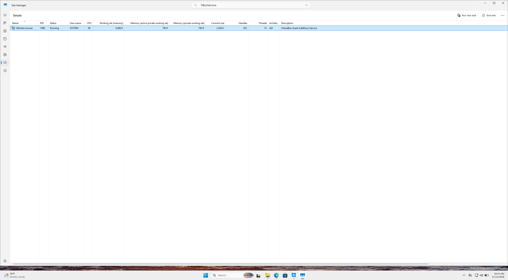
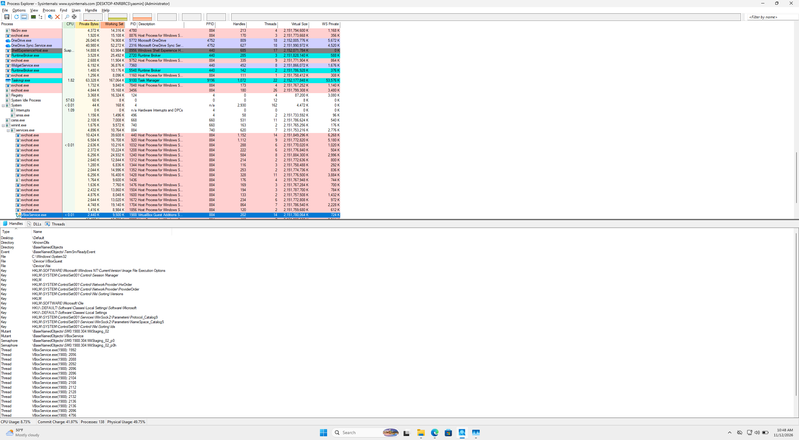
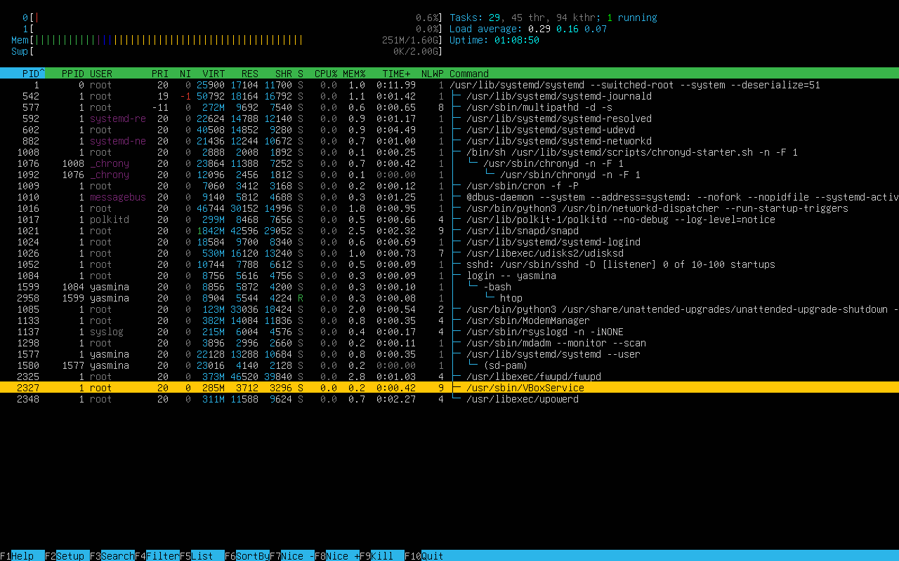

# Lab 6 — Live processes and memory pressure

Pair: Arsen Yermakanov + Yasmina Israilova (Исраилова Ясмина) · Group: CYB26-5 · Date: 14 November 2026
Guests:
- Part 1 — Yasmina's guests in Oracle VirtualBox: `lab01-ubuntu` — Ubuntu 26.04.1 LTS Server, 2 GB RAM (1.6 GiB usable) + 2 GB swap; `win11` — Windows 11 Enterprise Evaluation (build 26100), 6 GB RAM.
- Part 2 — my guest: Ubuntu Server 26.04 (ARM64) in UTM on a MacBook (Apple M1), 1.6 GiB RAM, 2 GiB swap file.

We did the lab as a pair. I have a Mac with UTM and no Windows guest, so Part 1 (Task Manager, Process Explorer and htop on the same process) was done on Yasmina's two VirtualBox guests, and Part 2 (memory pressure) on my own Ubuntu guest.

**From Yasmina's work I took only Part 1** — her comparison table, the "where the tools disagree" findings and the four Part 1 evidence files (`task-manager.png`, `process-explorer.png`, `htop.png`, `ps-fd.txt`). Everything in Part 2 (the stress-ng runs, `memory-pressure.txt`, `kernel-log-extract.txt`, the OOM analysis) is my own, from my own guest.

## Part 1 — One process, three tools

**Process chosen: the VirtualBox Guest Additions service** — `VBoxService.exe` on Windows, `/usr/sbin/VBoxService` on Ubuntu. Why: it is the same program on both guests, it runs all the time as a system service (so it has a real parent, handles and threads), and it hardly changes between screenshots.

On the Ubuntu guest VBoxService was not running at first (no Guest Additions on the server guest), so `virtualbox-guest-utils` was installed first — see "What did not work the first time".

All three tools were looked at in one sitting, within 8 minutes (host time, Almaty, 12 November):

| Evidence | Tool | Host time |
|---|---|---|
| [evidence/task-manager.png](evidence/task-manager.png) | Task Manager → Details, filtered on "VBoxService" | 14:44 |
| [evidence/process-explorer.png](evidence/process-explorer.png) | Process Explorer (as administrator), tree view + lower pane = Handles | 14:48 |
| [evidence/htop.png](evidence/htop.png) | htop, tree view, PPID and NLWP columns added | 14:51 |
| [evidence/ps-fd.txt](evidence/ps-fd.txt) | `ps`, `ls /proc/2327/fd`, `/proc/2327/status` | 14:52 |





### Comparison table

| | Task Manager | Process Explorer | htop / ps |
|---|---|---|---|
| PID | 1988 | 1988 | 2327 |
| Parent (name and PID) | — (not shown) | `services.exe` (884), a child of `wininit.exe` (740) | `systemd` (1) — PPID column / tree |
| "Memory" as shown by default | Memory (active private working set) = **740 K** | Private Bytes = **2,440 K** | RES = **3712 K** (MEM% 0.2) |
| Private memory | Memory (private working set) = 740 K; Commit size = 2,436 K | WS Private = 724 K; Private Bytes = 2,440 K | no column; `/proc` RssAnon = 416 kB |
| Working set / RES | Working set (memory) = 9,496 K | Working Set = 9,500 K | RES = 3712 K (`ps` RSS = 3712), of which SHR = 3296 K |
| Virtual size | no column | Virtual Size = 2,151,780,064 K (≈ 2 TB) | VIRT = 285M (`ps` VSZ = 292100 kB) |
| Handles / file descriptors | Handles = 202 | Handles = 202 (lower pane: Desktop, Directory, Event, File, Key, Mutant, Semaphore, Thread …) | 5 fds: `0,1,2 -> /dev/null`, `3 -> /dev/vboxguest`, `4 -> socket:[19686]` |
| Threads | 14 | 14 | NLWP = 9 (`Threads: 9` in `/proc/2327/status`) |
| CPU | 00 (%) | < 0.01 (%) | CPU% = 0.0, MEM% = 0.2 |
| User | SYSTEM | (Users column not added) | root |

### Where the tools disagree

1. **Parent.** Task Manager has no parent column at all. Process Explorer shows it as the line one level up in the tree: `services.exe` (PID 884), the Service Control Manager, which starts every Windows service. On Linux the parent is PID 1 `systemd`, the service manager there. Same role, different process, and only two of the three tools show it.
2. **"Memory" is three different numbers for the same process.** Task Manager's default "Memory" is the *active private working set* (740 K): private pages that are in RAM right now. Process Explorer's default is *Private Bytes* (2,440 K): all private memory the process has committed, including pages not in RAM. htop's RES (3712 K) counts every page in RAM, shared ones included — 3296 K of it is SHR, shared library pages; only RssAnon = 416 kB is really private. So the defaults cannot be compared, and Windows shows the smallest number by default.
3. **Same thing, different names.** *Commit size* (Task Manager, 2,436 K) = *Private Bytes* (Process Explorer, 2,440 K). *Memory (private working set)* (740 K) = *WS Private* (724 K). *Working set* is the Windows name for what Linux calls *RSS / RES* (9,496 K vs 9,500 K). The small gaps come from the 4 minutes between the two screenshots. htop has no column for committed private memory at all.
4. **Virtual size.** Task Manager does not show it. Process Explorer shows ≈ 2 TB for a service that uses 9 MB, because on 64-bit Windows the whole reserved address space counts. htop's VIRT (285 MB) is also mostly reserved, not used: VIRT is address space, not memory in use.
5. **Handles ≠ file descriptors.** 202 handles on Windows, 5 fds on Linux, for the same program. A Windows handle points to *any* kernel object — registry keys, events, mutexes, semaphores, even its own threads. A Linux fd only points to things in the file namespace: files, devices (`/dev/vboxguest`), sockets.
6. **Threads.** The two Windows tools agree (14). The Linux build of the same service runs 9 threads (htop needs `NLWP` added to show this).
7. **CPU %.** The service is idle, so all three show about zero, but the scale differs: Task Manager and Process Explorer count the *whole machine* as 100 %, htop counts *one core* as 100 % (a process can reach 200 % on 2 CPUs).
8. **Name.** Windows shows only the image name `VBoxService.exe`; htop shows the full command `/usr/sbin/VBoxService`.

## Part 2 — Memory pressure

Guest RAM: 1.6 GiB · swap: 2 GiB (`/swap.img`)

Steps, in order:

```
sudo apt install -y htop stress-ng
stress-ng --vm 2 --vm-bytes 70% --timeout 60s
stress-ng --vm 2 --vm-bytes 90% --timeout 60s
stress-ng --vm 2 --vm-bytes 120% --timeout 90s
stress-ng --vm 2 --vm-bytes 2G --vm-keep --timeout 120s
stress-ng --vm 2 --vm-bytes 5G --vm-keep --timeout 120s
```

Recording ran in a second SSH session with
`while true; do echo "=== $(date +%T) ==="; free -h; sleep 3; done | tee -a memory-pressure.txt`
([evidence/memory-pressure.txt](evidence/memory-pressure.txt), 261 samples).

| | Before (11:50:03) | During, worst (12:01:24) | After (12:03:54) |
|---|---|---|---|
| Available | 1.3 GiB | 63 MiB | 1.4 GiB |
| Swap used | 0 B | 2.0 GiB of 2.0 GiB | 68 MiB |

What happened:

- The 70 %, 90 % and 120 % runs did not run out of memory. `--vm-bytes` with a percentage is a percentage of the memory that is **free when stress-ng starts**, not of the total RAM, so even "120 %" stayed within what RAM plus swap could hold.
- `--vm-bytes 2G --vm-keep` (`--vm-keep` = keep the memory instead of freeing and re-allocating it each cycle): RAM filled up and swap grew to 1.1 GiB, but RAM + swap was still enough — no OOM.
- With `--vm-bytes 5G --vm-keep` (more than RAM + swap = 3.6 GiB), memory collapsed between two samples: at 12:00:23 available was 1.3 GiB and swap 20 MiB, at **12:00:26 available was 78 MiB and swap 1.0 GiB**. At **12:01:24** available was 63 MiB and swap was completely full (2.0 GiB used, 9.3 MiB free).
- Responsiveness: the recording shows the slowdown: the loop sleeps 3 s, but during the pressure the gaps between samples grew to 5 s (e.g. 12:00:34 → 12:00:39, 12:01:19 → 12:01:24) — the system was so busy swapping that even `free` and `date` started late.
- The process: the kernel kept killing stress-ng's memory workers, stress-ng kept restarting them, and memory came back as soon as the run ended (available 1.4 GiB at 12:03:54).

### What the kernel did

[evidence/kernel-log-extract.txt](evidence/kernel-log-extract.txt), from `journalctl -k --since "30 min ago" | grep -i -E -B3 -A8 "out of memory|oom-kill"`:

```
Nov 14 12:00:28 makromak kernel: stress-ng-vm invoked oom-killer: gfp_mask=0x440dc0(GFP_KERNEL_ACCOUNT|__GFP_ZERO|__GFP_COMP), order=0, oom_score_adj=1000
Nov 14 12:00:28 makromak kernel: Out of memory: Killed process 44222 (stress-ng-vm) total-vm:2649336kB, anon-rss:878964kB, file-rss:580kB, shmem-rss:0kB, UID:1000 pgtables:3796kB oom_score_adj:1000
```

- **Which process:** `stress-ng-vm`, PID 44222 — one of stress-ng's memory workers.
- **Why that one:** it was the biggest user of memory — about 2.5 GiB of address space (`total-vm:2649336kB`) and 858 MiB really in RAM (`anon-rss:878964kB`) — and stress-ng sets `oom_score_adj:1000` on its workers, the maximum, which tells the kernel "kill me first". So it was chosen before `sshd`, `bash` or my recording loop, and the system stayed alive.
- **When:** 12:00:28. In memory-pressure.txt this is right between the samples at 12:00:26 (available 78 MiB, swap 1.0 GiB) and the next one: RAM was gone and swap was filling, so the kernel could not find a free page and invoked the OOM killer.
- This was not a single event: the log has **41** "Out of memory: Killed process" lines between 12:00:28 and 12:02:24, all `stress-ng-vm`, because stress-ng restarts a worker each time one is killed.

The VM clock is in UTC and is not synchronised with my Mac, but the journal and memory-pressure.txt both use the same guest clock, so the times match each other.

### Windows

Not run by me: I have no Windows guest of my own (Mac with UTM). The query from the guide is

```
Get-WinEvent -FilterHashtable @{LogName='System'; ProviderName='Microsoft-Windows-Resource-Exhaustion-Detector'} -MaxEvents 5 | Format-List TimeCreated, Id, Message
```

What I would expect: Windows does not kill processes like the Linux OOM killer. When the commit charge gets close to the commit limit (RAM + page file), new allocations fail and programs get "out of memory" errors; the Resource-Exhaustion-Detector then writes event **2004** in the System log, naming the processes that used the most virtual memory. So Linux *acts* (kills a process and logs it), Windows *reports* (refuses allocations and logs who used the most).

## What did not work the first time

- **Part 1: VBoxService was not running on the Ubuntu guest.** `pgrep -a VBoxService` printed nothing — the server guest had no Guest Additions. After `sudo apt install -y virtualbox-guest-utils` it ran as PID 2327 under systemd, so the same program could be compared on both guests.
- **The percentage runs never triggered the OOM killer.** I expected `--vm-bytes 120%` to be more than the RAM, but the percentage is taken from the memory that is free at the start, so the run fitted into RAM plus swap. I had to give an absolute size larger than RAM + swap (1.6 GiB + 2 GiB) to make the kernel step in.
- **The size is the total, not per worker.** I first thought `--vm 2 --vm-bytes 2G` meant 2 GiB for each worker (4 GiB in total). In fact stress-ng splits `--vm-bytes` between the workers, so it was 2 GiB in total: swap grew to 1.1 GiB, but no OOM.
- **Wrong terminal tab.** I ran the `scp` that copies the evidence to my Mac inside the Ubuntu SSH session instead of the macOS tab, so the guest copied the files to itself (into its own `~/Downloads/lab06`) and nothing arrived on the Mac. The prompt tells them apart: `%` is macOS (zsh), `$` with `makro@makromak` is the Ubuntu guest.
- **htop F2 → "Columns" does not exist** in this htop version; the setting is now under F2 → Screens → Available Columns.
