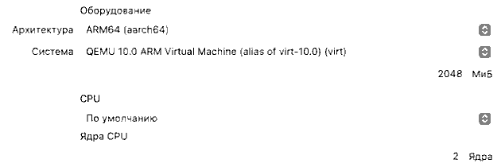
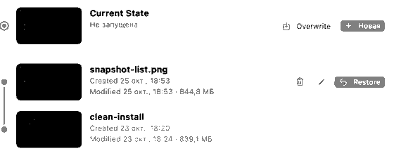

# Building a test computer for a new developer

**For:** Aigerim T. (Office Manager)
**Result:** two virtual computers inside the developer's laptop, one with Linux (Ubuntu Server) and one with Windows 11. He can break either of them and you can restore it in one click.
**Time:** about 2 hours, mostly waiting for downloads and installs.
**Cost:** nothing. All software below is free and legal for office use.

## Before you start: check the laptop

1. Open **Task Manager** (Ctrl + Shift + Esc) → **Performance** → **Memory**. Write down the total.
   - 16 GB or more: follow this guide as it is.
   - 8 GB: build both VMs, but run only one at a time.
2. In the same window, click **CPU** and look for **Virtualization: Enabled**.
   - If it says *Disabled*, stop and ask IT to turn it on in the BIOS. VirtualBox will not work without it.
3. Open **File Explorer** → **This PC**. You need at least **150 GB free** on drive C:.

*Why:* a virtual computer borrows memory and disk from the real one. If the laptop is too small, both will be slow.

## Step 1. Install VirtualBox

1. Go to https://www.virtualbox.org/wiki/Downloads and click **Windows hosts**.
2. Run the downloaded file and click **Next** on every screen, then **Install**. Accept the network warning. The Wi-Fi drops for a second, which is normal.

*Why VirtualBox:* it is free under the GPLv3 licence for any use, including in an office. VMware Workstation is also free now, but needs a Broadcom account. Hyper-V is not available on Windows Home.

> Check: VirtualBox opens and shows an empty list on the left.

## Step 2. Download the two installation files (ISOs)

1. **Ubuntu Server 26.04 LTS:** https://ubuntu.com/download/server → **Download**. The file is about 3 GB.
2. **Windows 11 Enterprise evaluation:** https://www.microsoft.com/en-us/evalcenter/download-windows-11-enterprise → fill in the form → **ISO – Enterprise, 64-bit, English**. The file is about 6 GB.

*Why the evaluation:* it is free and legal for 90 days without a product key. Do not use a key from the internet. **Write down today's date + 90 days** — after that Windows will ask for activation.

## Step 3. Create the shared network (once)

1. In VirtualBox: **File → Tools → Network Manager → NAT Networks** tab → **Create**.
2. Leave the name as **NatNetwork** and the address as **10.0.2.0/24**. Make sure **Enable DHCP** is ticked.

*Why NAT Network and not the default NAT:* with plain NAT each VM gets its own private router, so the two VMs cannot see each other. A NAT Network is one shared private network for both, with internet access through the laptop. We do not use Bridged because the university network blocks unknown devices by their hardware (MAC) address.

## Step 4. Create the Linux VM

1. Click **New**.
2. Name: `ubuntu-server`. ISO Image: choose the Ubuntu file from Step 2. Tick **Skip Unattended Installation**, so that you choose the settings yourself.
3. Memory: **4096 MB**. Processors: **2**.
4. Disk: **25 GB** is enough for a server without a desktop. Leave **Pre-allocate Full Size** unticked.
5. Click **Finish**.
6. Select the VM → **Settings → Network → Adapter 1** → Attached to: **NAT Network** → Name: **NatNetwork** → **OK**.

*Why 4 GB:* Ubuntu Server has no desktop and uses well under 1 GB at idle. 4 GB leaves room for the developer's tools. Two VMs at 4 GB each fit on a 16 GB laptop.

## Step 5. Install Ubuntu

1. Select `ubuntu-server` → **Start**.
2. Language: English. Keyboard: English (US). Type: **Ubuntu Server**.
3. Network: it shows an address like `10.0.2.x`. Press **Done**.
4. Storage: **Use an entire disk** → Done → **Continue**. This only erases the *virtual* disk, not the laptop.
5. Your name, server name `ubuntu-server`, username and password. **Write the password down** and give it to the developer.
6. Tick **Install OpenSSH server**. Skip the snaps. Wait, then choose **Reboot Now**. If it asks to remove the installation medium, press **Enter**.

> Check: after the reboot you see `ubuntu-server login:`. Log in, type `lsb_release -a` and press Enter. It should say `Ubuntu 26.04`.

## Step 6. Create the Windows VM

1. Click **New**. Name: `win11`. ISO: the Windows file from Step 2.
2. Memory **4096 MB**, Processors **4**.
3. Disk **64 GB**, dynamically allocated (Pre-allocate unticked).

4. After **Finish**, open **Settings → System**:
   - **Enable EFI** ticked
   - **Secure Boot** ticked
   - **TPM:** v2.0
5. **Settings → Network → Adapter 1** → **NAT Network** → **NatNetwork**.

*Why EFI, Secure Boot and TPM 2.0:* Windows 11 refuses to install without them ("This PC can't run Windows 11").
*Why 64 GB:* Windows 11 needs at least 64 GB. Because the disk is dynamically allocated, it only takes real space as Windows fills it.

## Step 7. Install Windows

1. **Start** the VM. If you see "Press any key to boot from CD", press a key at once.
2. Choose **I don't have a product key**, then **Windows 11 Enterprise Evaluation** → **Custom install** → the empty disk → **Next**.
3. When asked for a Microsoft account, choose **Domain join instead** / **Sign-in options → Offline account**, and create a local user.
4. Turn off all the privacy options.

> Check: press Win + R, type `winver`, press Enter. It should say **Windows 11 Enterprise Evaluation**.

*Note:* if you did not tick **Skip Unattended Installation** when creating the VM, VirtualBox installs Windows by itself and creates the user for you. That is also fine — just write down the username and password it shows in the wizard.

## Step 8. Let the two VMs ping each other

Windows blocks ping from other computers by default. Allow **only ping**, and keep the firewall on:

1. In Windows: Start → type `PowerShell` → **Run as administrator**.
2. Paste and press Enter:

   ```
   New-NetFirewallRule -DisplayName "Allow ping in (ICMPv4)" -Protocol ICMPv4 -IcmpType 8 -Direction Inbound -Action Allow
   ```

> Check — find the addresses, then ping both ways:
> - Ubuntu: `ip -br a` → e.g. `10.0.2.3`
> - Windows: `ipconfig` → e.g. `10.0.2.4`
> - Ubuntu: `ping -c 4 10.0.2.4` → `0% packet loss`
> - Windows: `ping 10.0.2.3` → `Lost = 0`
> - Both: `ping ubuntu.com` → replies (internet works)

## Step 9. Take the clean snapshot — do not skip this

1. Shut down both VMs (Ubuntu: `sudo poweroff`; Windows: Start → Shut down).
2. In VirtualBox, select the VM → click the **☰** menu next to it → **Snapshots** → **Take**.
3. Name it `clean-install`. Repeat for the other VM.

*Why:* this is what "without breaking anything" means. Whatever the developer does inside the VM, you can go back to this exact moment.

## Step 10. When the developer breaks a VM — roll back

1. Power off the broken VM (**Machine → ACPI Shutdown**, or **Power Off** if it is frozen).
2. **Snapshots** → select `clean-install` → **Restore** → untick "Create a snapshot of the current state" → **Restore**.
3. Start the VM. It is exactly as it was after installation.

> Check: anything the developer created after the snapshot is gone. Tell him to keep his own files outside the VM (GitHub, or a shared folder).

## If the laptop is a Mac with Apple Silicon (M1/M2/M3)

VirtualBox for Apple Silicon cannot run the normal Windows ISO, so on a Mac use **UTM** for the Linux VM. I tested this on my MacBook Air M1 with 8 GB.

1. Install UTM from https://mac.getutm.app (free, Apache 2.0 licence).
2. Download **Ubuntu Server 26.04 for ARM** (the *ARM 64-bit* ISO) from https://ubuntu.com/download/server/arm.
3. In UTM: **+** → **Virtualize** (not Emulate, which is very slow) → **Linux**. Untick **Use Apple Virtualization**, so that snapshots work. Choose the ISO.
4. Memory **2048 MB**, CPU **2 cores**, disk **14 GB**. Network: **Shared Network** (the default).

   
   

5. Install Ubuntu as in Step 5.
6. Shut down, then open the VM → **Snapshots** → **+ New** → name `clean-install`. To roll back: select it → **Restore**.

   

*Why 2 GB on an 8 GB Mac:* macOS needs about 6 GB to stay smooth. Ubuntu Server uses about 15% of 2 GB at idle.
*Why Shared Network:* the VM reaches the internet through the Mac, the same way NAT works in VirtualBox.

> Check: log in and run `ip -br a`. You should see an address like `192.168.64.2`. Then `ping -c 4 ubuntu.com` should show `0% packet loss`.

For Windows on a Mac, ask IT. It needs the ARM version of Windows 11 and a different setup, which this guide does not cover.

## If something goes wrong

| What you see | What it means | What to do |
|---|---|---|
| "VT-x/AMD-V is not available" or the VM will not start | Virtualization is off in the BIOS | Ask IT to enable it (see "Before you start") |
| "This PC can't run Windows 11" | EFI, Secure Boot or TPM is missing | Step 6.4, then start again |
| The VM is very slow and the laptop freezes | Too little memory left for the laptop | Run one VM at a time, or lower each to 3072 MB |
| Ubuntu cannot ping Windows (100% loss) | The Windows firewall blocks ping | Step 8 |
| No internet in a VM | The adapter is not on NatNetwork | Step 4.6 / Step 6.5 |
| Windows asks for activation | The 90-day evaluation is over | Ask IT for a licence, or rebuild with a new evaluation ISO |
